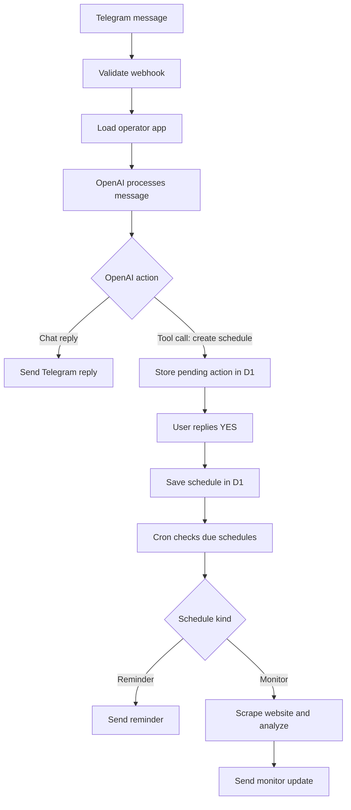

# switch-operator

`switch-operator` is a Cloudflare Worker-based Telegram operator. It exposes a
webhook-driven interface for OpenAI-backed replies,
persists reminder and monitoring schedules in Cloudflare D1, and executes due
jobs on a cron trigger.

The current feature set includes:

- Webhook authentication, request validation, and access control
- OpenAI-backed chat replies
- Scheduled reminders and recurring messages
- Website monitoring with Telegram notifications

## Tech Stack

- **Runtime:** Cloudflare Workers
- **Framework:** Hono
- **Language:** TypeScript (strict)
- **Messaging:** Telegram Bot API
- **LLM:** OpenAI API
- **Validation:** Zod
- **Monorepo:** pnpm workspaces + Turborepo
- **Tooling:** oxlint (type-aware), oxfmt, Knip

## Structure

```
apps/
  operator/         # Cloudflare Worker (Telegram bot)
  browser-scraper/  # Cloudflare Worker (headless browser scraping)
  alerts/           # Cloudflare Worker (scheduled market alerts)
packages/
  alpha-vantage/    # Alpha Vantage market data client
  http-client/      # Shared fetch wrapper with response validation
  logger/           # Shared structured logger
  telegram/         # Telegram Bot API client
  typescript/       # Shared TypeScript config
  url-validator/    # Safety policy checks for user-supplied URLs
.github/            # CI workflow, composite setup action, secrets-scan script
.oxlintrc.json      # Single root lint config
.oxfmtrc.jsonc      # Single root format config
```

## Flow



## Development

Requires Node 24 (exact version in `.nvmrc`) and pnpm 12 (see `packageManager`).

```sh
pnpm install          # install dependencies
pnpm dev              # start local dev server
pnpm build            # build all workspaces
pnpm typecheck        # type checking
pnpm lint             # oxlint
pnpm knip             # unused files, exports and dependencies
pnpm test             # run tests
pnpm secrets:scan     # gitleaks over git history
pnpm format:check     # check formatting
pnpm format           # fix formatting
```

For local Telegram bot testing you also need
[cloudflared](https://developers.cloudflare.com/cloudflare-one/connections/connect-networks/downloads/)
to tunnel to your local worker. See
[apps/operator/README.md](apps/operator/README.md) for full setup instructions
(`.dev.vars`, D1 migrations, webhook registration, production secrets).

## CI and repo settings

CI (`.github/workflows/ci.yml`) runs typecheck, lint, knip, format:check, test, a
gitleaks secret scan, CodeQL and actionlint + zizmor over the workflow files on PRs and
on push to `main`. The `all-passed` job fans them in; on `main` the `deploy` job then
deploys the workers. GitHub settings this relies on:

1. **Rules → Rulesets**: the `main` ruleset requires a pull request and the
   `all-passed` status check, the only one to list.
2. **Environments → production**: a deployment-branch rule allowing `main` only, with
   `CLOUDFLARE_API_TOKEN` and `CLOUDFLARE_ACCOUNT_ID` as environment secrets.
3. **Code security → Code scanning**: _default setup_ **off**, or GitHub rejects the
   CodeQL uploads from `ci.yml`.
4. **Code security → Dependabot**: **alerts** on, **security updates** off.
   `.github/dependabot.yml` only bumps the SHA-pinned GitHub Actions monthly.
5. **Issues**: run the `Maintenance dashboard` workflow once, then pin the
   **Maintenance dashboard** issue it creates.
